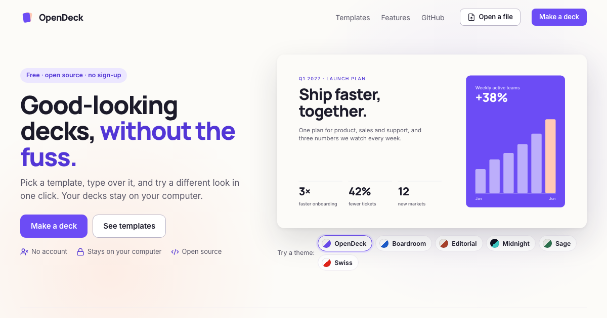

# OpenDeck

Good-looking presentations, without the fuss. Pick a template, type over it, and try a different look in one click. OpenDeck runs entirely in your browser: no account, no server, and your decks stay on your computer.

[](https://www.gnu.org/licenses/agpl-3.0)


**Use it at [opendeck.work](https://opendeck.work/).**



## Features

- **Templates to start from.** 37 slide layouts (titles, agendas, numbers, charts, quotes, timelines, team, code and more) and ready-made starter decks. Every slide keeps its layout, so text you type stays in place.
- **Themes in one click.** Switch the whole deck between built-in themes, or make a brand kit with your own colours, fonts and logo and reuse it across decks.
- **Move anything.** Drag, resize, rotate, align and group anything on a slide. Simple mode keeps the editor calm; Advanced adds layers, exact positions, fonts and effects.
- **Present from one screen.** Your slides open in their own window to share in a call, while your tab becomes a speaker view with notes, the next slide and a timer. Full screen works too.
- **Share it your way.** Download a single HTML file that plays offline in any browser, save as PDF, or export an `.odeck` file to back up or hand over a deck.
- **Stay organised.** Folders, tags, pinned decks and a Trash that keeps deleted decks for 30 days.

## Privacy

- Your decks, pictures and fonts are stored in your browser (IndexedDB) and never leave your computer.
- There are no accounts and no server that stores your work.
- Visitor counts (Cloudflare Web Analytics) load only if you allow them, and you can turn them off at any time from Privacy (at the bottom of the start page, and in the Home sidebar). They never see your decks.

## Decks from the previous version

Decks made with the previous version of OpenDeck come over automatically the first time you open the new one in the same browser, with their folders and tags. The previous version's data is only read, never changed. If you edit a deck in the previous version later, **Import → From V1** brings the new edits over as a fresh copy.

The previous version stays available at [opendeck.work/v1/](https://opendeck.work/v1/) for a while.

## Run it locally

The app lives in `app/` (Vite, React and TypeScript). You need Node.js 22.12 or newer.

```bash
cd app
npm ci
npm run dev          # development server
npm test             # unit tests
npm run typecheck
npm run test:e2e     # end-to-end tests (Playwright; builds the site first)
npm run build:site   # production build in app/dist, with the previous version at /v1/
```

The previous version's files are in `v1/` and are copied into the build as they are.

## License

OpenDeck is licensed under the [GNU Affero General Public License v3.0](LICENSE).
